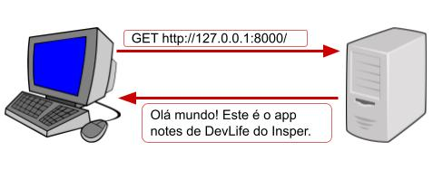
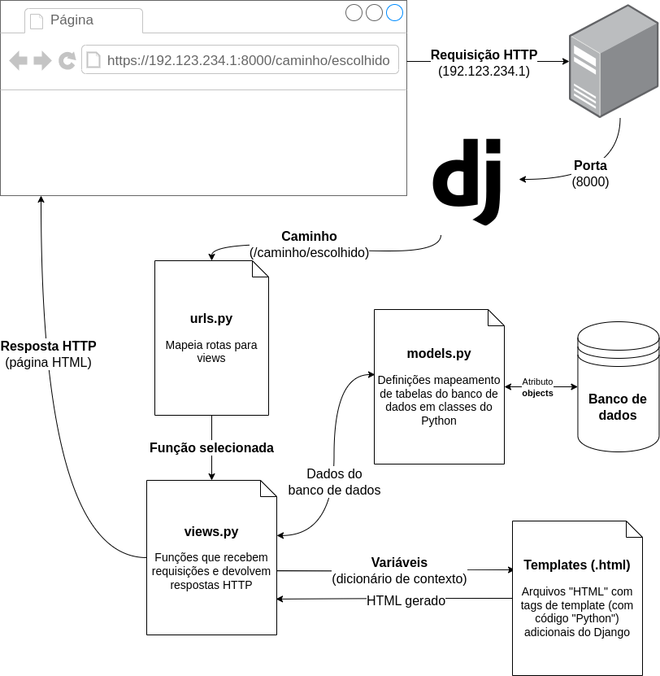

<!-- _class: lead -->
# 01. Introdução à Web e ao Django
### Da Biblioteca ao Framework Web

**Projeto da Trilha:** Sistema de Anotações **Get-it**
Django 6.X • Python

---

## Biblioteca vs. Framework

<div class="cols">
<div>

### Biblioteca (ex: Pygame)
- Você escreve o `while True` principal
- **Seu código chama** as funções da biblioteca quando quer
- Você controla o fluxo de execução

</div>
<div>

### Framework (ex: Django)
- A estrutura principal **já está pronta**
- Você define funções e classes no padrão exigido
- **O framework chama o seu código** no momento certo (*Inversão de Controle*)

</div>
</div>

<div class="warn">
<strong>Aprendendo a aprender:</strong> Sempre consulte a documentação oficial do <strong>Django 6.X</strong>.
</div>

---

## Como a Internet Funciona: IP e Porta

Para dois programas conversarem na rede, precisamos de **duas informações**:

- **Endereço IP (`192.168.0.1`):** Identifica **qual computador** (dispositivo) na rede.
- **Porta (`8000`):** Identifica **qual programa** dentro daquele computador.

```text
192.168.0.1:8000
└────┬────┘ └─┬┘
Computador   Programa (Servidor Django)
```

---

## Anatomia de uma URL

Quando digitamos um endereço no navegador, usamos uma **URL** (*Uniform Resource Locator*):

```text
http://192.168.32.18:8000/imagens/logotipo.png
└─┬┘   └─────┬─────┘ └─┬┘└─────────┬─────────┘
Protocolo Endereço   Porta      Caminho (Path)
```

- **Protocolo (`http` / `https`):** Regra de comunicação.
- **Endereço (`insper.edu.br` $\rightarrow$ DNS $\rightarrow$ IP):** Localização do servidor.
- **Porta (`8000`):** Porta do servidor web.
- **Caminho (`/imagens/logotipo.png`):** Qual recurso queremos acessar.

---

## Ciclo Requisição $\leftrightarrow$ Resposta

<div class="cols">
<div>

1. **Cliente (Navegador)** envia uma **Requisição (*Request*)** pedindo um caminho.
2. **Servidor (Django)** processa o pedido e devolve uma **Resposta (*Response*)** com HTML.
3. Ao ler `` ou `<link href=".css">`, o navegador faz **novas requisições** para buscar cada arquivo.

</div>
<div>



</div>
</div>

---

## O Fluxo Interno do Django (Arquitetura MVT)



---

## Resumo do Fluxo no Servidor (6 Passos)

1. **Requisição** chega ao servidor na porta `8000`.
2. **`urls.py`** analisa o caminho recebido e escolhe qual função executar.
3. **`views.py`** tem sua função chamada (recebe `request`).
4. **`models.py`** é usado pela view para consultar/salvar no **Banco de Dados**.
5. **`templates/`** é usado pela view para montar o **HTML** com os dados.
6. **Resposta HTTP** é devolvida pela view para o navegador.

<div class="box">
<strong>Próximo passo:</strong> Preparar nosso ambiente virtual e criar o projeto <code>getit</code>!
</div>
