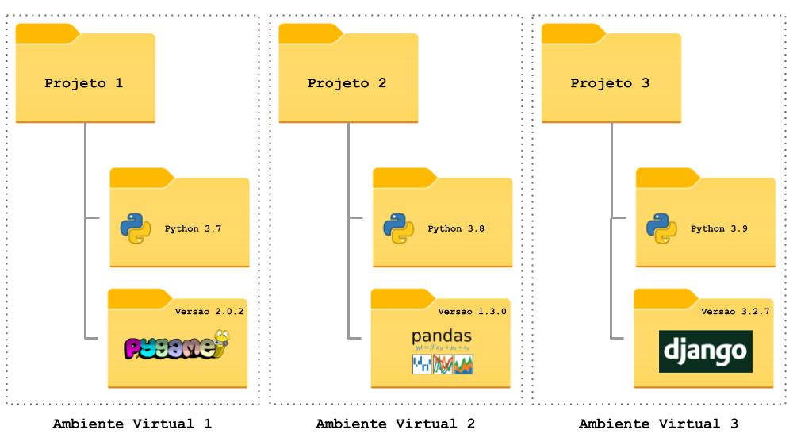
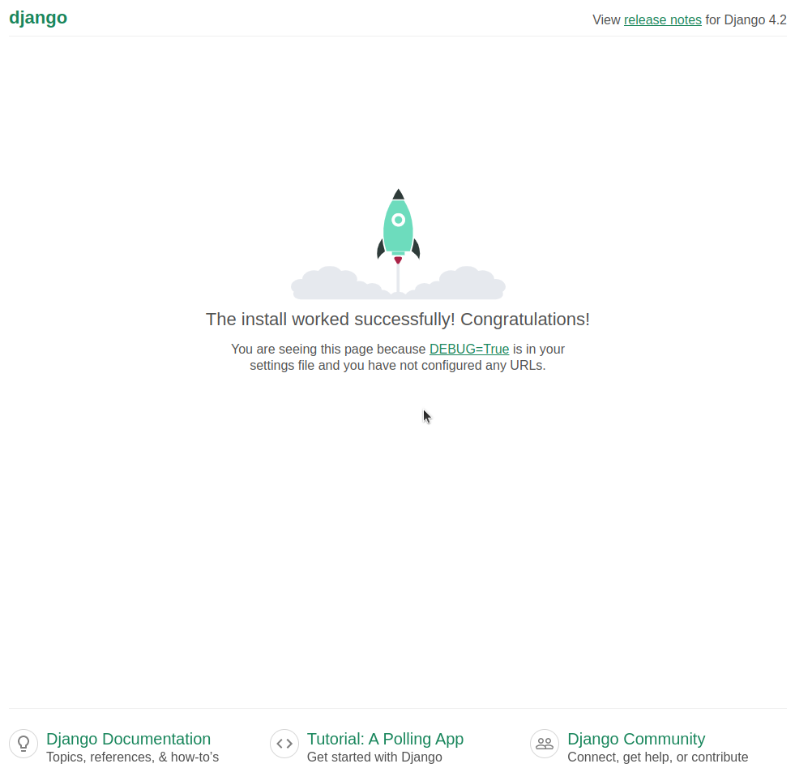
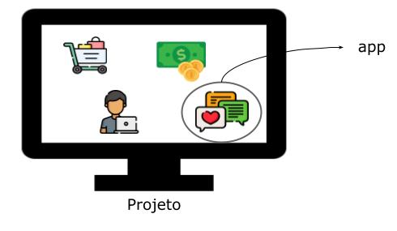

<!-- _class: lead -->
# 02. Configuração, Venv e Estrutura
### Criando o projeto **Get-it** e o app **notes**

**Entrega vinculada:** Check 1

---

## Por que Ambiente Virtual (`venv`)?

<div class="cols">
<div>

- Projetos diferentes exigem **versões diferentes** das mesmas bibliotecas.
- O `venv` cria uma instalação isolada do Python exclusiva para a pasta do projeto.
- Arquivo `requirements.txt` lista os pacotes necessários:
  ```text
  Django
  ```

</div>
<div>



</div>
</div>

---

## Criando e Ativando o `venv`

<div class="cols">
<div>

### Opção 1: VS Code
1. `F1` $\rightarrow$ `Python: Create Environment`
2. Selecionar `Venv` $\rightarrow$ versão do Python
3. Marcar `requirements.txt`

</div>
<div>

### Opção 2: Terminal

**macOS / Linux:**
```bash
python3 -m venv .venv --prompt .
. .venv/bin/activate
pip install -r requirements.txt
```

**Windows (PowerShell):**
```powershell
python3 -m venv .venv --prompt .
. .venv\Scripts\Activate.ps1
pip install -r requirements.txt
```

</div>
</div>

---

## Gerando a Estrutura do Projeto

Com o `.venv` ativo, criamos o projeto `getit` na pasta atual:

```bash
django-admin startproject getit .
```

<div class="warn">
<strong>Atenção ao ponto (<code>.</code>) no final!</strong> Sem ele, o Django criará uma pasta extra desnecessária.
</div>

```text
pasta-do-projeto/
├── .venv/
├── manage.py          # Comandos de automação (runserver, migrate, startapp...)
└── getit/
    ├── settings.py    # Configurações globais do projeto
    ├── urls.py        # Roteamento principal de URLs
    └── wsgi.py / asgi.py
```

---

## Testando o Servidor (Check 1)

<div class="cols">
<div>

Execute no terminal:

```bash
python manage.py runserver
```

Acesse no navegador:
**`http://localhost:8000`**

<div class="box">
<strong>Check 1:</strong> Servidor rodando localmente em <code>localhost:8000</code> sem erros! Faça commit e valide com o professor.
</div>

</div>
<div>



</div>
</div>

---

## Conceito: Projeto vs. App

<div class="cols">
<div>

- **Projeto (`getit`):** O sistema completo e suas configurações.
- **App (`notes`):** Um módulo focado em uma tarefa específica (ex: notas, pagamentos, usuários).

Criando nosso app:
```bash
python manage.py startapp notes
```

</div>
<div>



</div>
</div>

---

## Registrando o App no `settings.py`

Todo app criado **precisa** ser listado em `INSTALLED_APPS`:

**Arquivo:** `getit/settings.py`
```python
INSTALLED_APPS = [
    'notes.apps.NotesConfig',  # <-- Adicione como primeiro item (não esqueça a vírgula!)
    'django.contrib.admin',
    'django.contrib.auth',
    'django.contrib.contenttypes',
    'django.contrib.sessions',
    'django.contrib.messages',
    'django.contrib.staticfiles',
]
```

<div class="warn">
<strong>Crucial:</strong> Sem registrar o app no <code>settings.py</code>, o Django ignorará nossos modelos e templates!
</div>
