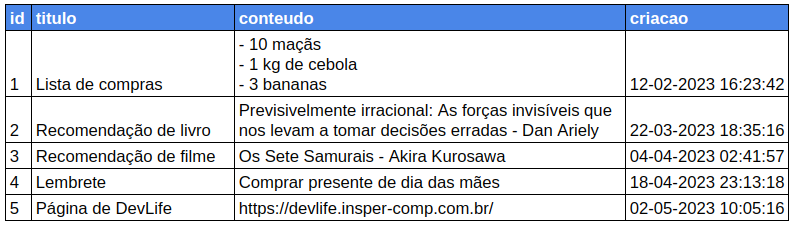
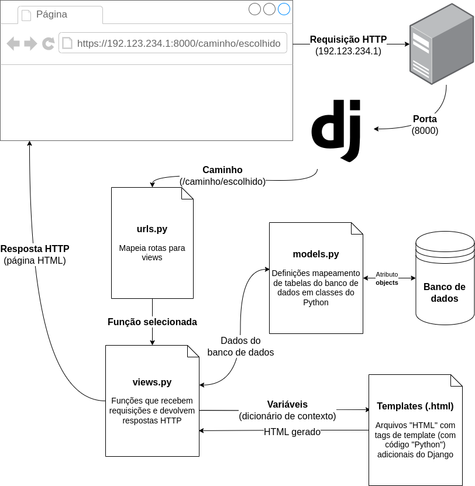
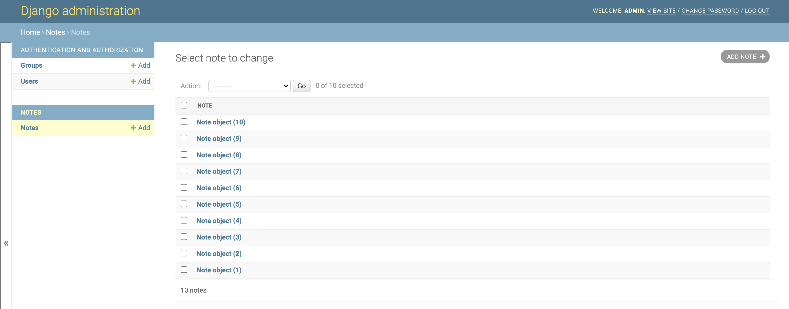
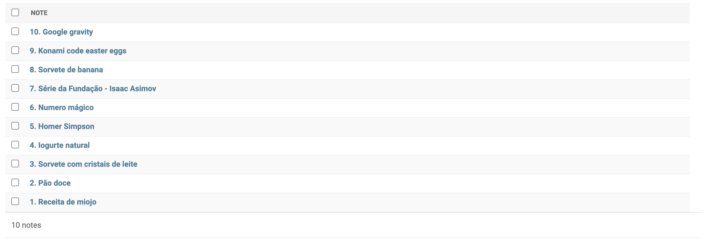

<!-- _class: lead -->
# 03. Modelagem Inicial, Migrações e Admin
### Persistindo dados no Banco de Dados

**Entrega vinculada:** Check 2 + Exercício *Criando alguns modelos*

---

## Onde estamos no Fluxo do Django?

<div class="cols">
<div>

Foco desta etapa:
- **`models.py`** $\leftrightarrow$ **Banco de Dados**
- Cada classe Python que herda de `models.Model` vira uma **tabela** no banco de dados.



</div>
<div>



</div>
</div>

---

## Construindo o Modelo `Note`

**Arquivo:** `notes/models.py`

```python
from django.db import models

class Note(models.Model):
    title = models.CharField(max_length=200)
    content = models.TextField()
    created_at = models.DateTimeField(auto_now_add=True)
```

- **`CharField(max_length=200)`:** Texto curto com limite de caracteres.
- **`TextField()`:** Texto livre longo (sem limite fixo).
- **`DateTimeField(auto_now_add=True)`:** Salva data/hora automaticamente **na criação** (enquanto `auto_now=True` atualiza em toda edição).
- **E a coluna `id`?** O Django cria automaticamente!

---

## Criando e Aplicando Migrações

Alterar `models.py` não muda o banco sozinho. Precisamos de **2 passos**:

```bash
# 1. Gera o arquivo de instruções (planta da mudança)
python manage.py makemigrations

# 2. Aplica as instruções nas tabelas do banco de dados
python manage.py migrate
```

<div class="box">
<strong>Regra de bolso:</strong>
• Mudou o <code>models.py</code>? Rode <code>makemigrations</code> e depois <code>migrate</code>.<br>
• Baixou o projeto em outro computador? Rode apenas <code>migrate</code>.
</div>

---

## Django Admin: Gerenciamento Rápido

1. Crie um superusuário no terminal:
   ```bash
   python manage.py createsuperuser
   ```
2. Registre o modelo no arquivo **`notes/admin.py`**:
   ```python
   from django.contrib import admin
   from .models import Note

   admin.site.register(Note)
   ```
3. Acesse **`http://localhost:8000/admin/`** e crie algumas anotações!

---

## Melhorando a Exibição com `__str__`

<div class="cols">
<div>

Sem `__str__`: mostra `Note object (1)`.
Adicione em **`notes/models.py`**:

```python
class Note(models.Model):
    title = models.CharField(max_length=200)
    content = models.TextField()
    created_at = models.DateTimeField(
        auto_now_add=True
    )

    def __str__(self):
        return f"{self.id}. {self.title}"
```

</div>
<div>


$\downarrow$


</div>
</div>

---

## Hora da Prática: Exercício + Check 2

<div class="cols">
<div>

### Exercício no VS Code
**"Criando alguns modelos"** (`Produto`)
- `nome`: `CharField` (máx 100)
- `descricao`: `TextField(blank=True)`
- `preco`: `DecimalField` (2 casas)
- `foto`: `ImageField(upload_to='uploads/imgs/')`
- `ultima_modificacao`: `DateTimeField(auto_now=True)`

</div>
<div>

### Checklist do Check 2
1. App `notes` em `INSTALLED_APPS`
2. Classe `Note` (`title`, `content`, `created_at`)
3. `makemigrations` + `migrate`
4. Superusuário criado
5. `Note` registrado no `admin.py`
6. 5 anotações criadas via Admin
7. Método `__str__` no formato `ID. TITULO`

</div>
</div>
