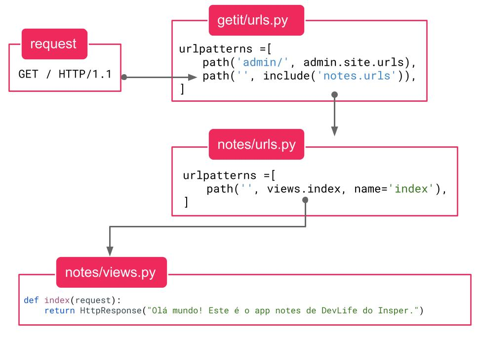

<!-- _class: lead -->
# 04. URLs e Views
### Como o caminho digitado no navegador chega até a sua função Python

**Entrega vinculada:** Check 3 + Exercício *Mapeando rotas*

---

## O Caminho da Requisição: `urls.py` $\rightarrow$ `views.py`



Quando você acessa `http://localhost:8000/`:
1. O Django extrai o caminho após a porta (neste caso, a string vazia `""`).
2. Procura na lista `urlpatterns` de **`getit/urls.py`** quem atende esse caminho.
3. Repassa a busca para **`notes/urls.py`**, que chama a função `views.index(request)`.

---

## Como Funciona o `getit/urls.py`?

**Arquivo:** `getit/urls.py` *(roteador central do projeto)*
```python
from django.contrib import admin
from django.urls import include, path

urlpatterns = [
    path('admin/', admin.site.urls),   # (1) Se começar com "admin/", vai para o Django Admin
    path('', include('notes.urls')),   # (2) Qualquer outro caminho é repassado para notes/urls.py
]
```

### O que acontece se invertermos a ordem de (1) e (2)?
- O Django testa a lista `urlpatterns` **de cima para baixo** e para no primeiro que combinar.
- Como `''` (string vazia) é prefixo de qualquer texto, se `path('', ...)` vier primeiro, tentar acessar `/admin/` vai cair no `notes.urls` e o **Django Admin para de funcionar**!

---

## Como `notes/urls.py` se Conecta com `notes/views.py`?

<div class="cols">
<div>

**1. Arquivo:** `notes/urls.py`
```python
from django.urls import path
from . import views

urlpatterns = [
    path('', views.index, name='index'),
]
```

</div>
<div>

**2. Arquivo:** `notes/views.py`
```python
from django.http import HttpResponse

def index(request):
    return HttpResponse(
        "Olá mundo! Este é o app notes."
    )
```

</div>
</div>

### O que cada peça significa?
- **`''`:** Caminho vazio (`http://localhost:8000/`).
- **`views.index` (sem parênteses!):** Passamos a **própria função** como referência para o Django guardá-la e só executá-la quando um usuário acessar a rota.
- **`name='index'`:** Apelido único dessa rota (usaremos mais tarde para redirecionamentos).
- **`request`:** Objeto que o Django entrega para sua função contendo todas as informações do pedido do navegador.

---

## Devolvendo HTML na Resposta

O navegador interpreta qualquer string dentro de `HttpResponse` como **código HTML**:

**Arquivo:** `notes/views.py`
```python
from django.http import HttpResponse

def index(request):
    html = """
    <h1>Olá mundo!</h1>
    <p>Este é o app notes de <em>DevLife do Insper</em>.</p>
    """
    return HttpResponse(html)
```

- `<h1>` vira título principal, `<p>` vira parágrafo e `<em>` deixa o texto em itálico no navegador.

---

## Erros Clássicos neste Módulo (e como resolver)

| Mensagem de Erro | Por que aconteceu? | Como corrigir? |
| :--- | :--- | :--- |
| `ModuleNotFoundError: No module named 'notes.urls'` | Você colocou `include('notes.urls')` no `getit/urls.py`, mas ainda não criou o arquivo `notes/urls.py`. | Crie o arquivo `notes/urls.py` com a lista `urlpatterns`. |
| `TypeError: index() missing 1 required positional argument: 'request'` | Você escreveu `path('', views.index())` **com parênteses** no `urls.py`, chamando a função na hora errada. | Remova os parênteses: `path('', views.index)`. |
| `ValueError: The view notes.views.index didn't return an HttpResponse object` | Sua função em `views.py` retornou uma string pura (`return "oi"`) ou não teve `return`. | Envolva o retorno em `return HttpResponse("...")`. |

---

## Hora da Prática: Exercício + Check 3

<div class="cols">
<div>

### Exercício no VS Code
**"Mapeando rotas"**
Em `app_principal/urls.py` e `views.py`:
- `/comida` $\rightarrow$ `baião de dois`
- `/filme` $\rightarrow$ `Estrelas Além do Tempo`
- `/livro` $\rightarrow$ `O Design do Dia a Dia`

</div>
<div>

### Check 3 (no Get-it)
1. Adicione a rota `'creditos/'` em `notes/urls.py`.
2. Crie a função correspondente em `notes/views.py`.
3. Ao acessar **`http://localhost:8000/creditos/`**, deve exibir:
```html
<h1>Créditos</h1>
<p>Sistema web desenvolvido por SEU_NOME</p>
```

</div>
</div>
