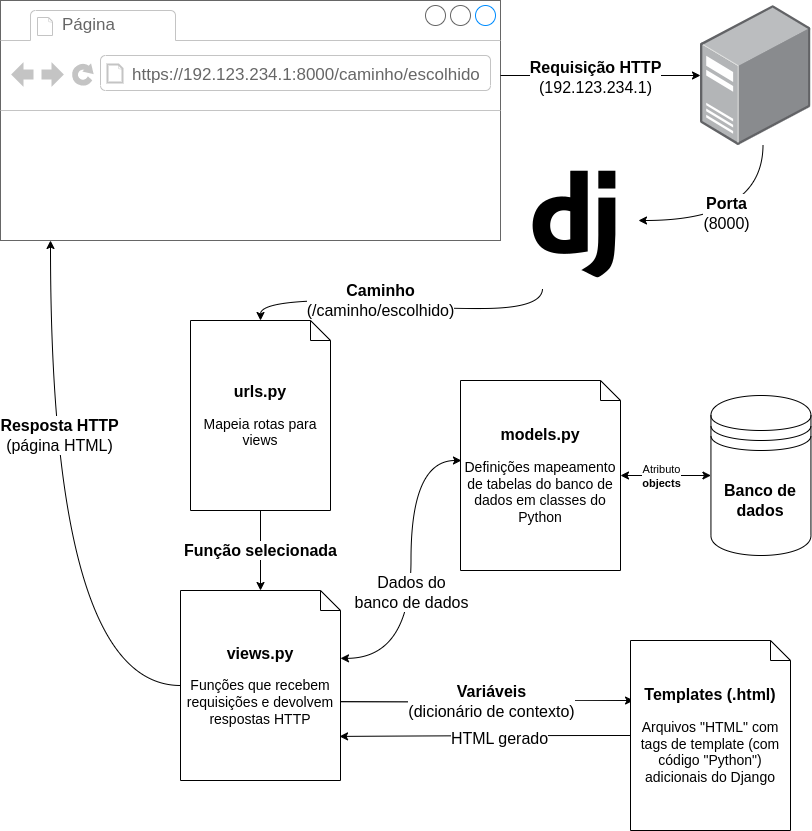

<!-- _class: lead -->
# 05. Models, Views e URLs
### Como a View busca dados no Banco usando `QuerySets`

**Entrega vinculada:** Check 4

---

## Onde estamos na Arquitetura do Django?

<div class="cols">
<div>

Agora vamos ligar as pontas que criamos nos Módulos 03 e 04:
1. O navegador pede `http://localhost:8000/`.
2. `urls.py` chama `views.index(request)`.
3. **`views.index` usa `Note.objects` (de `models.py`) para buscar as anotações salvas no banco!**
4. A view monta um HTML com os títulos e devolve ao navegador.

</div>
<div>



</div>
</div>

---

## Como `Note.objects` Funciona nos Bastidores?

Toda classe que herda de `models.Model` ganha automaticamente um gerenciador chamado **`objects`**:

```python
# Arquivo: notes/views.py
from django.http import HttpResponse
from .models import Note

def index(request):
    all_notes = Note.objects.all()     # (1) Consulta todas as linhas da tabela Note
    items = ""
    for note in all_notes:             # (2) Percorre cada objeto Note retornado
        items += f"<li>{note.title}</li>"  # (3) Acessa a coluna title como atributo Python

    return HttpResponse(f"<h1>Get-it</h1><ul>{items}</ul>")
```

- **O que é `all_notes`?** É um **`QuerySet`** — um objeto do Django que se comporta como uma lista de instâncias `Note` vindas do banco de dados.

---

## Caixa de Ferramentas do `QuerySet`

Em vez de buscar tudo e filtrar com `if` no Python, pedimos para o próprio **Banco de Dados** filtrar ou ordenar (muito mais rápido!):

| Método | O que o Django pede ao banco de dados? | Exemplo prático |
| :--- | :--- | :--- |
| **`.all()`** | *"Traga todas as linhas da tabela"* | `Note.objects.all()` |
| **`.filter(campo=valor)`** | *"Traga apenas as linhas onde a coluna tem esse valor"* | `Note.objects.filter(title="Compras")` |
| **`.exclude(campo=valor)`**| *"Traga todas as linhas, EXCETO as que têm esse valor"* | `Note.objects.exclude(id=1)` |
| **`.order_by('campo')`** | *"Ordene em ordem crescente por esta coluna"* | `Note.objects.order_by('created_at')` |
| **`.order_by('-campo')`** | *"Ordene em ordem **decrescente** (sinal de `-` na frente)"* | `Note.objects.order_by('-created_at')` |
| **`.distinct()`** | *"Remova linhas duplicadas do resultado"* | `Note.objects.distinct()` |

---

## Hora da Prática: Check 4

Modifique a função `index` em **`notes/views.py`** para que ao acessar `http://localhost:8000/`:

1. Busque todas as anotações ordenadas da **mais recente para a mais antiga**:
   ```python
   all_notes = Note.objects.order_by('-created_at')
   ```
2. Construa uma string HTML contendo uma lista `<ul>` onde cada `<li>` exibe o `note.title`:
   ```html
   <h1>Get-it</h1>
   <ul>
     <li>Última anotação criada</li>
     <li>Anotação anterior</li>
   </ul>
   ```

<div class="box">
<strong>Reflita:</strong> Já pensou escrever uma página inteira com CSS, formulários e botões dentro de uma string Python na view? No próximo módulo resolveremos isso com <strong>Templates</strong>!
</div>
