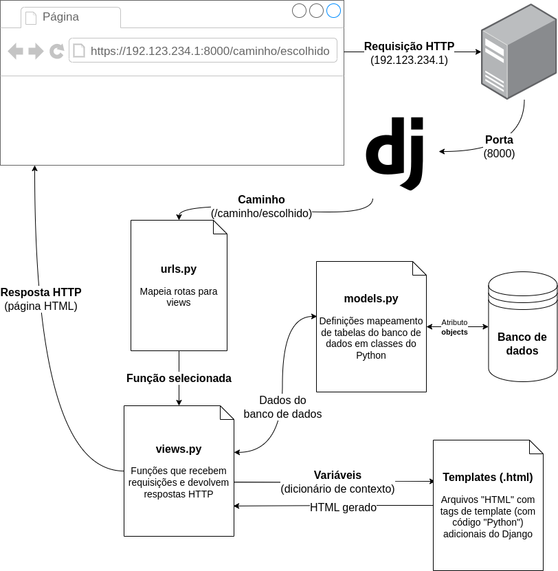

<!-- _class: lead -->
# 06. Templates HTML e Herança
### Como a View envia variáveis do Python para um arquivo HTML separado

**Entrega vinculada:** Check 5

---

## Onde estamos na Arquitetura do Django?

<div class="cols">
<div>

Em vez de concatenar strings HTML dentro de `views.py`, agora a view usa um **molde HTML (`templates/`)**:
1. A view busca `all_notes` no banco via `models.py`.
2. A view chama **`render()`**, enviando o molde HTML + um **dicionário de contexto**.
3. O motor de templates do Django preenche o molde e devolve HTML puro para o navegador!

</div>
<div>



</div>
</div>

---

## Como a View se Conecta com o Template?

Observe como a chave do dicionário na view vira o nome da variável dentro do HTML:

<div class="cols">
<div>

**1. Na View (`notes/views.py`):**
```python
from django.shortcuts import render
from .models import Note

def index(request):
    all_notes = Note.objects.order_by('-created_at')
    return render(
        request,
        'notes/index.html',       # (A) Arquivo HTML
        {'notes': all_notes}      # (B) Contexto
    )
```

</div>
<div>

**2. No Template (`notes/templates/notes/index.html`):**
```html
<ul>
  
    <li>{{ note.title }} - {{ note.content }}</li>
  
    <li>Nenhuma anotação por enquanto.</li>
  
</ul>
```

</div>
</div>

- **`'notes'` (chave do dicionário em B)** $\longleftrightarrow$ vira a variável **`notes`** usada no ``!
- **Importante:** O navegador nunca vê `` ou `{{ note.title }}`. O Django executa isso no servidor e entrega apenas `<li>...</li>` prontos!

---

## Os 4 Elementos do Template Django (DTL)

| Sintaxe | Nome | O que acontece quando o Django processa? |
| :--- | :--- | :--- |
| **`{{ variavel }}`** | **Variável** | Avalia a expressão e substitui pelo valor texto no HTML final (ex: `{{ note.title }}`). |
| **``** | **Tag de lógica** | Executa controle de fluxo como ` ... ` ou ` ... `. |
| **``** | **Cláusula vazia** | Usada dentro de ``: seu bloco só aparece se a lista estiver vazia! |
| **`{# texto #}`** | **Comentário** | Ignorado completamente pelo Django (não vai para o HTML final enviado ao navegador). |

<div class="warn">
<strong>Por que existe <code></code>?</strong> Porque no HTML os espaços e indentações não definem blocos como no Python — o Django precisa saber exatamente onde o <code>for</code> termina!
</div>

---

## Por que a pasta é `notes/templates/notes/`?

Parece estranho repetir `notes` duas vezes:
```text
notes/
└── templates/
    └── notes/
        ├── base.html
        └── index.html
```

**O motivo técnico (Namespacing):**
- Quando você chama `render(request, 'index.html')`, o Django junta as pastas `templates/` de **todos os apps instalados** em uma única busca.
- Se dois apps tiverem um `templates/index.html`, um sobrescreve o outro!
- Colocando dentro de `notes/templates/notes/index.html`, referenciamos de forma única como `'notes/index.html'`.

---

## Herança de Templates: Como `extends` e `block` Funcionam?

Para não repetir `<!DOCTYPE html>`, `<head>`, menu e rodapé em todas as telas:

<div class="cols">
<div>

**Molde Pai (`notes/templates/notes/base.html`):**
```html
<!DOCTYPE html>
<html>
  <head>
    <meta charset="UTF-8" />
    <title>Get-it</title>
  </head>
  <body>
    <!-- Espaço reservado chamado "content" -->
     
  </body>
</html>
```

</div>
<div>

**Página Filha (`notes/templates/notes/index.html`):**
```html



  <h1>Get-it</h1>
  <ul>
    
      <li>
        <strong>{{ note.title }}</strong>:
        {{ note.content }}
      </li>
    
      <li>Nenhuma anotação por enquanto.</li>
    
  </ul>

```

</div>
</div>

- O Django carrega o `base.html` inteiro e **encaixa** o conteúdo de `` do `index.html` exatamente no buraco `` do `base.html`!

---

## Hora da Prática: Check 5

1. Crie a pasta `notes/templates/notes/`.
2. Crie `base.html` com a estrutura HTML base e ``.
3. Crie `index.html` herdando de `base.html` (``) e exibindo **título e conteúdo** de cada anotação.
4. Na view `index`, troque `HttpResponse` por `render(request, 'notes/index.html', {'notes': all_notes})`.
