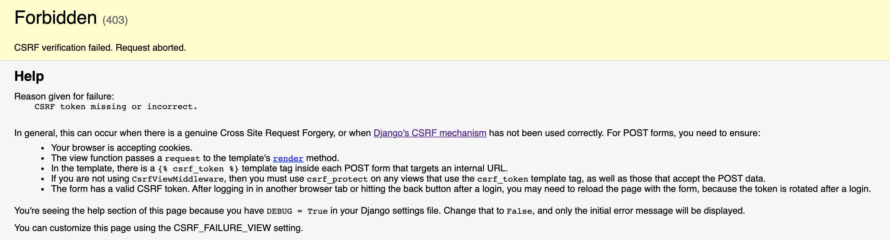

<!-- _class: lead -->
# 07. Formulários e o Método POST
### Enviando dados do navegador para criar registros no banco

**Entrega vinculada:** Check 6

---

## Verbos HTTP: `GET` vs. `POST`

<div class="cols">
<div>

### `GET` (Leitura)
- Usado ao digitar uma URL ou clicar em um link
- **Solicita** uma página ou recurso ao servidor
- Não deve alterar dados no banco

</div>
<div>

### `POST` (Escrita / Envio)
- Usado ao submeter um `<form method="post">`
- **Envia dados** no corpo da requisição para criar/modificar registros

</div>
</div>

---

## Criando o Formulário com Proteção CSRF

<div class="cols">
<div>

**Arquivo:** `notes/templates/notes/index.html`
```html
<form method="post" action="/">
  
  <label for="titulo">Título</label>
  <input id="titulo" type="text" name="titulo" />

  <label for="detalhes">Detalhes</label>
  <textarea id="detalhes" name="detalhes"></textarea>

  <input type="submit" />
</form>
```
- O atributo **`name`** define a chave do dicionário recebido no servidor!

</div>
<div>


Sem ``, o Django bloqueia o POST com erro **403 Forbidden** contra ataques *Cross-Site Request Forgery*.

</div>
</div>

---

## Recebendo o POST e Redirecionando (Padrão PRG)

Se devolvermos `render()` direto no POST, dar **F5 (recarregar)** duplica a anotação!
Solução: **Post $\rightarrow$ Redirect $\rightarrow$ Get**.

**Arquivo:** `notes/views.py`
```python
from django.shortcuts import render, redirect
from .models import Note

def index(request):
    if request.method == 'POST':
        title = request.POST.get('titulo')
        content = request.POST.get('detalhes')
        Note.objects.create(title=title, content=content)
        return redirect('index')  # Redireciona (Status 302) para nova requisição GET!
    else:
        all_notes = Note.objects.order_by('-created_at')
        return render(request, 'notes/index.html', {'notes': all_notes})
```

---

## Hora da Prática: Check 6

1. Adicione o `<form method="post">` com `` na página inicial (`index.html`).
2. Na view `index`, trate `request.method == 'POST'`.
3. Crie e salve a nova anotação no banco de dados.
4. Faça `return redirect('index')` após salvar.

<div class="box">
<strong>Teste de validação:</strong> Crie uma anotação pelo formulário e recarregue a página (F5) — ela <strong>não</strong> deve ser duplicada!
</div>
