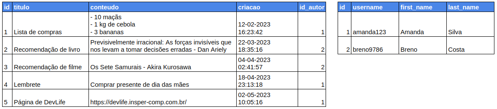

<!-- _class: lead -->
# 11. Relacionamentos Entre Modelos
### Como funciona uma Chave Estrangeira (`ForeignKey`) no banco e no Django

**Entrega vinculada:** Check 10

---

## Como o Banco de Dados Liga Duas Tabelas?

<div class="cols">
<div>

No momento, qualquer usuário logado vê as anotações de **todo mundo**, porque a tabela `Note` não guarda quem criou cada nota!

### Como resolver em bancos relacionais:
- Adicionamos uma coluna na tabela de anotações que armazena o **`id` do usuário** na tabela `User`.
- Essa coluna que aponta para o `id` de outra tabela é chamada de **Chave Estrangeira (*Foreign Key*)**.

</div>
<div>



</div>
</div>

---

## Anatomia do `ForeignKey` no `models.py`

**Arquivo:** `notes/models.py`
```python
class Note(models.Model):
    title = models.CharField(max_length=200)
    content = models.TextField()
    created_at = models.DateTimeField(auto_now_add=True)
    owner = models.ForeignKey("auth.User", on_delete=models.CASCADE)  # <-- Nova coluna!
```

### O que significam os dois argumentos de `ForeignKey`?
1. **`"auth.User"`:** Indica qual modelo/tabela estamos apontando (o modelo `User` do app nativo `auth`).
2. **`on_delete=models.CASCADE`:** Regra de integridade do banco — se o usuário dono for deletado do sistema, todas as anotações dele são apagadas em cascata para não ficarem "órfãs".

---

## O que Acontece no `makemigrations`? (Dúvida Clássica)

Quando você roda `python manage.py makemigrations`, o Django faz uma pergunta no terminal:

```text
It is impossible to add a non-nullable field 'owner' to note without specifying a default.
Please select a fix:
 1) Provide a one-off default now (will be set on all existing rows)
 2) Quit and manually define a default value in models.py.
Select an option: 1
Please enter the default value as valid Python: 1
```

### Por que o Django perguntou isso?
- Você já tem 5 anotações antigas salvas no banco (do Check 2), que foram criadas **antes** da coluna `owner` existir.
- Como toda anotação agora é obrigada a ter um `owner`, o Django pergunta: *"Qual ID de usuário devo colocar nas anotações antigas que já estão no banco?"*
- Digitando `1` (opção 1) e depois `1` (ID do seu superusuário), todas as notas antigas passam a pertencer ao usuário `1`! Depois, basta rodar `python manage.py migrate`.

---

## Vinculando e Filtrando pelo Usuário Logado (`request.user`)

Toda requisição autenticada traz o objeto do usuário atual em **`request.user`**:

```python
# Arquivo: notes/views.py
@login_required
def index(request):
    if request.method == 'POST':
        title = request.POST.get('titulo')
        content = request.POST.get('detalhes')
        # (1) Salva o usuário logado como dono da nova anotação:
        Note.objects.create(title=title, content=content, owner=request.user)
        return redirect('index')

    # (2) Busca APENAS as anotações cujo owner é o usuário logado:
    user_notes = Note.objects.filter(owner=request.user).order_by('-created_at')
    return render(request, 'notes/index.html', {'notes': user_notes})
```

<div class="box">
<strong>Por que colocamos <code>.filter(...)</code> antes de <code>.order_by(...)</code>?</strong><br>
Porque filtrar primeiro descarta todas as anotações de outros usuários imediatamente, deixando muito menos linhas para o banco ordenar!
</div>

---

## Hora da Prática: Check 10

1. Adicione o campo `owner = models.ForeignKey("auth.User", on_delete=models.CASCADE)` na classe `Note`.
2. Rode `makemigrations` (informando o usuário padrão `1`) e depois `migrate`.
3. Na criação de notas (`views.py`), salve `owner=request.user`.
4. Na listagem da página inicial, filtre com `Note.objects.filter(owner=request.user).order_by('-created_at')`.
5. Crie um segundo usuário no `/admin/`, faça login com ele e comprove que cada usuário vê apenas suas próprias anotações!
