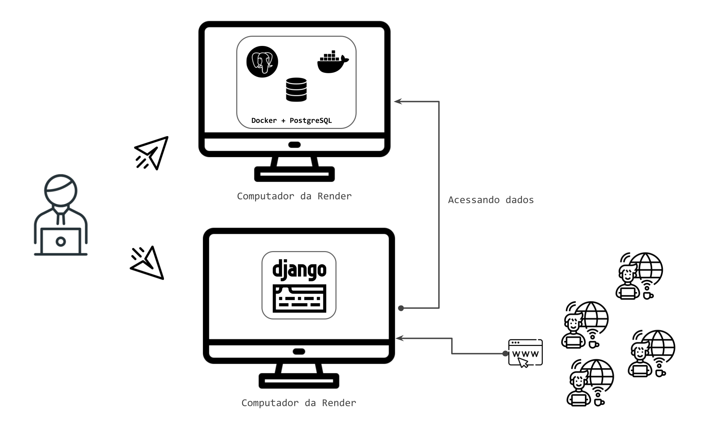
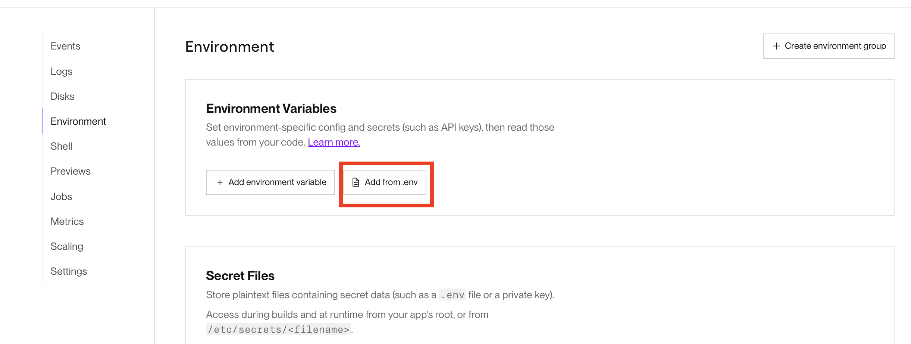

<!-- _class: lead -->
# 13. Deploy da Aplicação
### Do `localhost` (SQLite) para a Nuvem (Render + PostgreSQL)

---

## Desenvolvimento Local vs. Produção na Nuvem

### Local (`localhost:8000`)
- Roda apenas na sua máquina
- Banco em arquivo local (**SQLite**)
- `python manage.py runserver`

### Produção (Render)
- Servidor público disponível 24/7
- Banco relacional robusto (**PostgreSQL**)
- Servidor WSGI de produção (**Gunicorn** + **WhiteNoise**)

---

## Variáveis de Ambiente e Segurança

**Nunca** suba senhas ou chaves secretas direto no código do GitHub!

Configuramos no painel do Render (`Environment Variables`):
- `DATABASE_URL` (conexão PostgreSQL)
- `SECRET_KEY`
- `DEBUG = False`
- `PYTHON_VERSION`

---

## Passo a Passo Resumido de Publicação

1. **Criar instância PostgreSQL no Render** e copiar a *Internal Database URL*.
2. **Preparar o projeto Django:**
   - `dj-database-url`, `psycopg2-binary`, `gunicorn`, `whitenoise` no `requirements.txt`
   - Script `build.sh` executando `pip install`, `collectstatic` e `migrate`
3. **Criar Web Service no Render** conectado ao repositório GitHub:
   - **Build Command:** `./build.sh`
   - **Start Command:** `gunicorn getit.wsgi:application`

<strong>Alternativa para testes rápidos locais:</strong> Use o <strong>Ngrok</strong> (<code>ngrok http 8000</code>) adicionando o domínio gerado em <code>ALLOWED_HOSTS</code> e <code>CSRF_TRUSTED_ORIGINS</code>.

