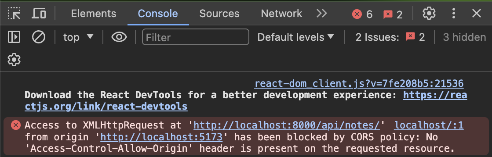

<!-- _class: lead -->
# 14. Django REST Framework e React
### Como separar o Backend (API JSON) do Frontend (React)

---

## O que Muda: Django Tradicional vs. API REST

<div class="cols">
<div>

### Django Tradicional (Módulos 01 a 11)
- A view busca os dados no banco, mistura com um template HTML e devolve a **página HTML inteira**.
- Toda ação recarrega a tela.

### Arquitetura Desacoplada (API REST + React)
- **Backend (Django REST):** Não tem templates HTML! Ele devolve apenas **dados puros em formato JSON**.
- **Frontend (React):** Roda no navegador, pede o JSON para o Django e atualiza a tela instantaneamente sem recarregar!

</div>
<div>


</div>
</div>

---

## O que é um Serializador (`serializers.py`)?

O navegador/React não entende objetos Python do tipo `Note`. Precisamos traduzir o objeto Python para texto **JSON** (processo chamado de **Serialização**):

<div class="cols">
<div>

**Arquivo:** `notes/serializers.py`
```python
from rest_framework import serializers
from .models import Note

class NoteSerializer(serializers.ModelSerializer):
    class Meta:
        model = Note
        fields = ['id', 'title', 'content']
```

</div>
<div>

**O que `NoteSerializer(note).data` produz:**
```json
{
  "id": 1,
  "title": "Receita de miojo",
  "content": "Misture o tempero..."
}
```
> Se passarmos uma lista de notas, usamos `NoteSerializer(all_notes, many=True)`.

</div>
</div>

---

## Anatomia de uma View de API no DRF (`@api_view`)

Compare como a view agora devolve `Response(serialized.data)` em vez de `render(...)`:

**Arquivo:** `notes/views.py`
```python
from rest_framework.decorators import api_view
from rest_framework.response import Response
from .models import Note
from .serializers import NoteSerializer

@api_view(['GET', 'POST'])                      # (1) Declara quais verbos HTTP a rota aceita
def api_notes(request):
    if request.method == 'POST':
        new_note_data = request.data            # (2) Lê o JSON enviado pelo React
        Note.objects.create(
            title=new_note_data['title'],
            content=new_note_data['content']
        )

    all_notes = Note.objects.all()              # (3) Busca as notas no banco
    serialized = NoteSerializer(all_notes, many=True) # (4) Converte a lista de Note para JSON
    return Response(serialized.data)            # (5) Devolve a resposta JSON para o cliente
```

---

## Como o React Conversa com o Django? (`useState` + `useEffect`)

<div class="cols">
<div>

No projeto React (`src/App.jsx`):
```jsx
function App() {
  // (1) Estado que guarda a lista de notas na tela:
  const [notes, setNotes] = useState([]);

  // (2) Roda 1 vez quando a tela abre, buscando o JSON no Django:
  useEffect(() => {
    axios
      .get("http://localhost:8000/notes/")
      .then((res) => setNotes(res.data));
  }, []);

  return (
    <main>
      {notes.map((note) => (
        <Note key={note.id} title={note.title}>
          {note.content}
        </Note>
      ))}
    </main>
  );
}
```

</div>
<div>

### O que acontece passo a passo?
1. O React abre em `localhost:5173` com `notes = []`.
2. O `useEffect` dispara um `GET` via **Axios** para `localhost:8000/notes/`.
3. O Django devolve a lista em JSON.
4. O `.then((res) => setNotes(res.data))` atualiza o estado `notes` e o React desenha os cards na tela automaticamente!

</div>
</div>

---

## Por que dá Erro de CORS (e como corrigir)?

<div class="cols">
<div>

- O React roda na porta **`5173`** (`http://localhost:5173`).
- O Django roda na porta **`8000`** (`http://localhost:8000`).
- Por segurança, o navegador bloqueia chamadas JavaScript entre portas/domínios diferentes se o servidor não autorizar explicitamente (**CORS** — *Cross-Origin Resource Sharing*).

**Solução no Django (`settings.py`):**
Instalar `django-cors-headers` e liberar a origem do React em `CORS_ALLOWED_ORIGINS`.

</div>
<div>



</div>
</div>

---

## Conexão com a Sprint Session (Projeto Final)

| Conceito | O que o seu projeto precisa demonstrar |
| :--- | :--- |
| **Conceito C** | Telas principais funcionando, filtros de dados, login/logout/recuperação de senha, leitura de `.xlsx` salvando no banco e controle de permissões (cliente vs. admin). |
| **Conceito B** | **Arquitetura desacoplada com API REST (Django REST Framework)**, registro e visualização de log de navegação do usuário, e variáveis de ambiente seguras. |
| **Conceito A / A+** | **Deploy completo em nuvem**, assistente de IA ou funcionalidade avançada integrada, filtros combináveis e gráficos claros. |
