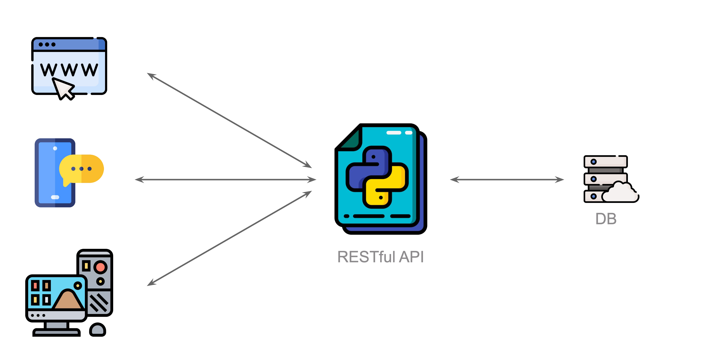
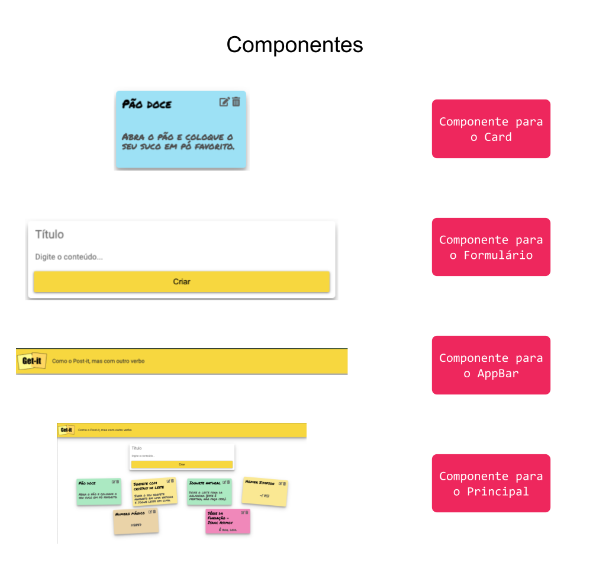

<!-- _class: lead -->
# 14. Django REST Framework e React
### Desacoplando Backend (API JSON) e Frontend (SPA)

---

## Django Tradicional vs. API REST

<div class="cols">
<div>

### Django Tradicional
- Servidor devolve **HTML pronto**
- Acoplado a uma única interface web

### API REST (Django REST Framework)
- Servidor devolve apenas **dados em JSON**
- Consumido por **React**, Apps Mobile e sistemas externos

</div>
<div>



</div>
</div>

---

## Serializador: Objeto Python $\leftrightarrow$ JSON

Instale `djangorestframework` e adicione `'rest_framework'` em `INSTALLED_APPS`.

**Arquivo:** `notes/serializers.py`
```python
from rest_framework import serializers
from .models import Note

class NoteSerializer(serializers.ModelSerializer):
    class Meta:
        model = Note
        fields = ['id', 'title', 'content']
```

Resultado serializado em JSON:
```json
[{"id": 1, "title": "Receita de miojo", "content": "Misture o tempero..."}]
```

---

## Views da API no Django REST Framework (`@api_view`)

**Arquivo:** `notes/views.py`
```python
from rest_framework.decorators import api_view
from rest_framework.response import Response
from .models import Note
from .serializers import NoteSerializer

@api_view(['GET', 'POST'])
def api_notes(request):
    if request.method == 'POST':
        new_note_data = request.data
        Note.objects.create(
            title=new_note_data['title'],
            content=new_note_data['content']
        )
    all_notes = Note.objects.all()
    serialized = NoteSerializer(all_notes, many=True)
    return Response(serialized.data)
```

---

## Frontend em React: Componentes, `useState` e `useEffect`

<div class="cols">
<div>

```jsx
function App() {
  const [notes, setNotes] = useState([]);

  useEffect(() => {
    axios
      .get("http://localhost:8000/api/notes/")
      .then((res) => setNotes(res.data));
  }, []);

  return (
    <>
      <AppBar />
      <Formulario onSubmit={...} />
      {notes.map((n) => (
        <Note key={n.id} title={n.title}>
          {n.content}
        </Note>
      ))}
    </>
  );
}
```

</div>
<div>



<div class="warn">
<strong>CORS:</strong> Como React (porta 5173) e Django (porta 8000) rodam em origens diferentes, instale e configure <code>django-cors-headers</code> no backend!
</div>

</div>
</div>

---

## Conexão com a Sprint Session (Projeto Final)

| Conceito | Requisitos Técnicos de Arquitetura |
| :--- | :--- |
| **Conceito C** | Telas principais, filtros, login/logout, recuperação de senha, importação `.xlsx` para o banco e controle de acesso (cliente vs. admin). |
| **Conceito B** | **Desacoplamento Frontend/Backend via API REST (DRF)**, log de navegação do usuário e credenciais em variáveis de ambiente. |
| **Conceito A / A+** | **Deploy em nuvem realizado**, assistente de IA ou feature avançada integrada, filtros combináveis e visualizações/gráficos completos. |
